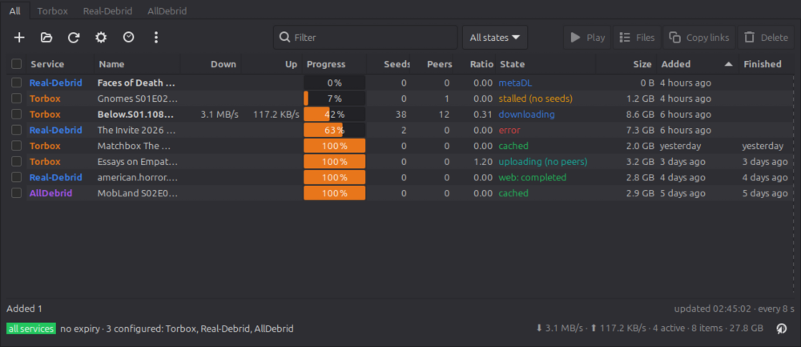

# Debrid Applet

A tray app for Linux Mint that puts your **Torbox**, **Real-Debrid** and **AllDebrid** accounts in one window.
See what's downloading, add magnets and torrents, play or download the results, and let it watch folders and
feeds for you.



## Install

Download the `.deb` from the [latest release](https://github.com/xb00tt/debrid-applet/releases) and install it:

```bash
sudo apt install ./debrid-applet_1.0.5_all.deb
```

It starts with your session from now on. To start it right away, look for **Debrid Applet** in the menu.

Prefer running from source? Clone the repo and run `./install.sh`.

## First run

1. Right-click the tray icon → **Settings…**.
2. Paste the API key of each service you use (Torbox: Settings → API; Real-Debrid: real-debrid.com/apitoken;
   AllDebrid: alldebrid.com/apikeys). Services you leave empty just stay out of the way.
3. **Test keys**, then **Save**.

Keys stay on your machine in `~/.config/debrid-applet/config.json`, readable only by you. Once a day the applet asks
`api.github.com` for the latest release (nothing else is sent); turn that off under Settings → Advanced.

## Everyday use

- **Left-click the tray icon** to show or hide the window; right-click for Refresh, Settings and Quit. The number
  next to the icon is how many items are still downloading.
- **Add things** with the `+` button (magnets and hoster links, one per line), the folder button (`.torrent`
  files), or by dropping files, links or magnets onto the window. Copy a magnet anywhere and a notification
  offers to add it.
- **Tick rows** (or just click one) and use **Play**, **Files**, **Copy links** or **Delete**. Right-click a row
  for more, including sending it to another service.
- **Find things** with the filter box and the state and added-within dropdowns (last 7 days by default, change it
  in Settings); click column headers to sort.
- The **All** tab shows every service together (TB / RD / AD in its Service column; full names via Settings); the
  other tabs show one service each.

- **Updates** announce themselves: a notification offers to download, verify and install a new release (one password
  prompt), then restart. Or right-click the tray icon → Check for updates…

Everything else, from watch folders and RSS feeds to the local API and keyboard shortcuts, is described in the
[manual](docs/MANUAL.md).

## Trouble?

Open the activity log (clock icon in the toolbar) to see what the applet did and what the services answered.
More in the manual's [troubleshooting section](docs/MANUAL.md#troubleshooting).

## License

MIT, see `LICENSE`. Contributions and packaging notes: [docs/DEVELOPING.md](docs/DEVELOPING.md).
